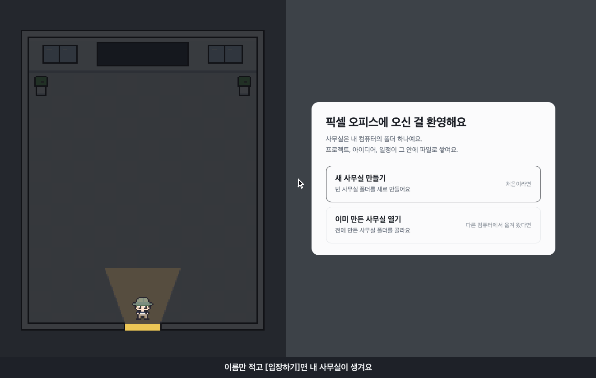
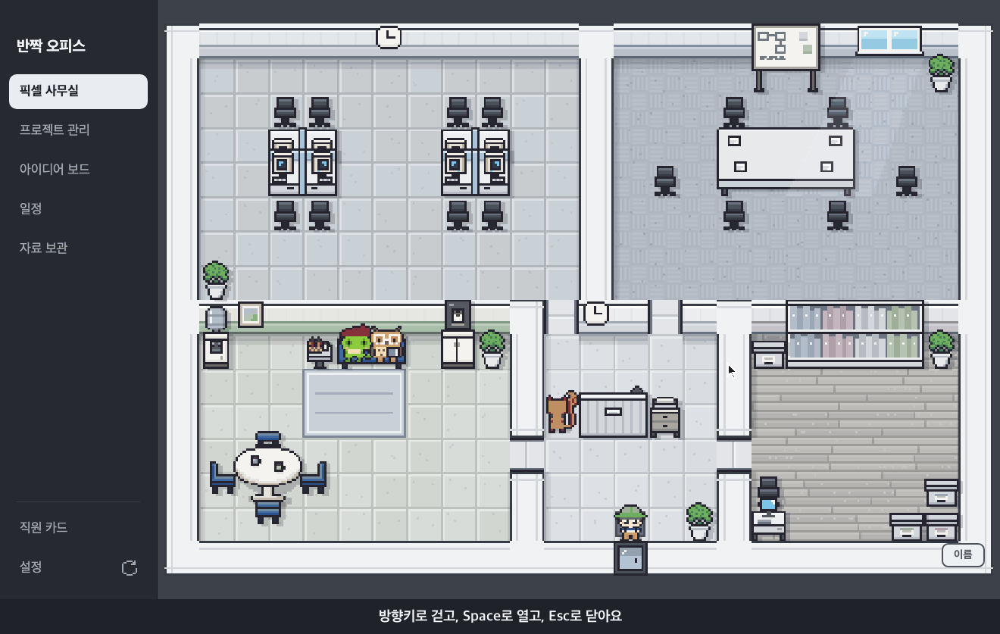
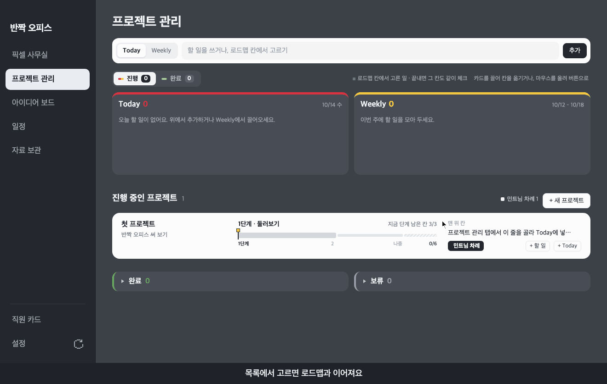
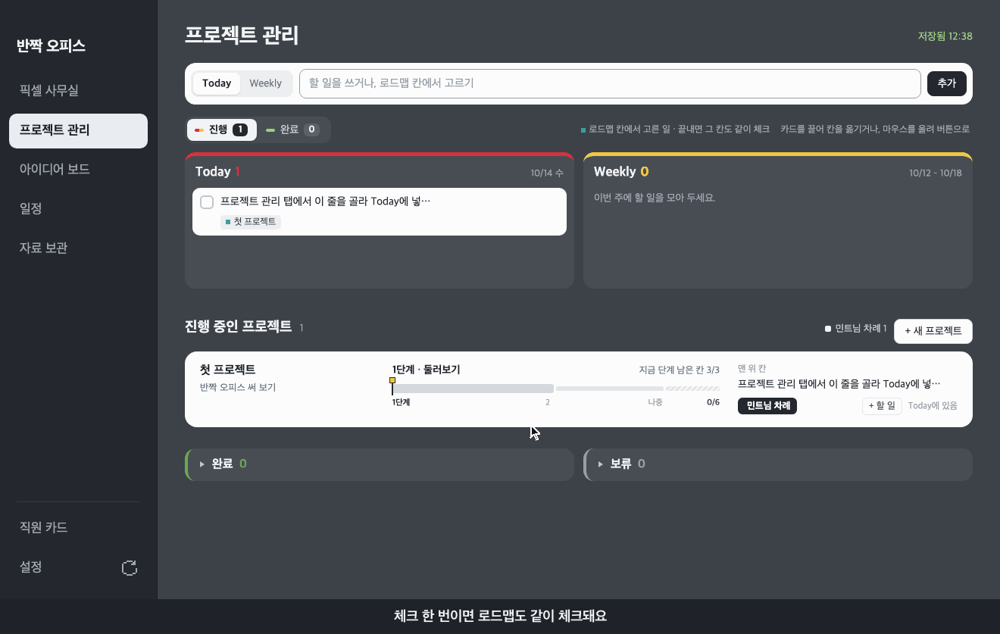
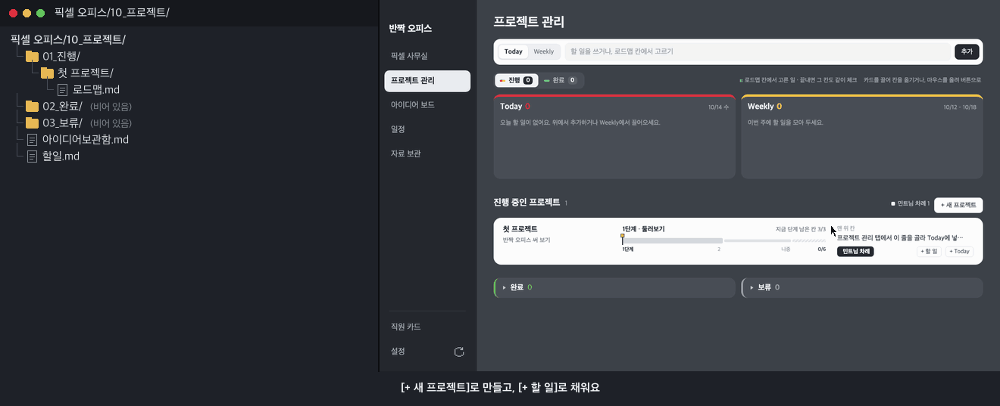
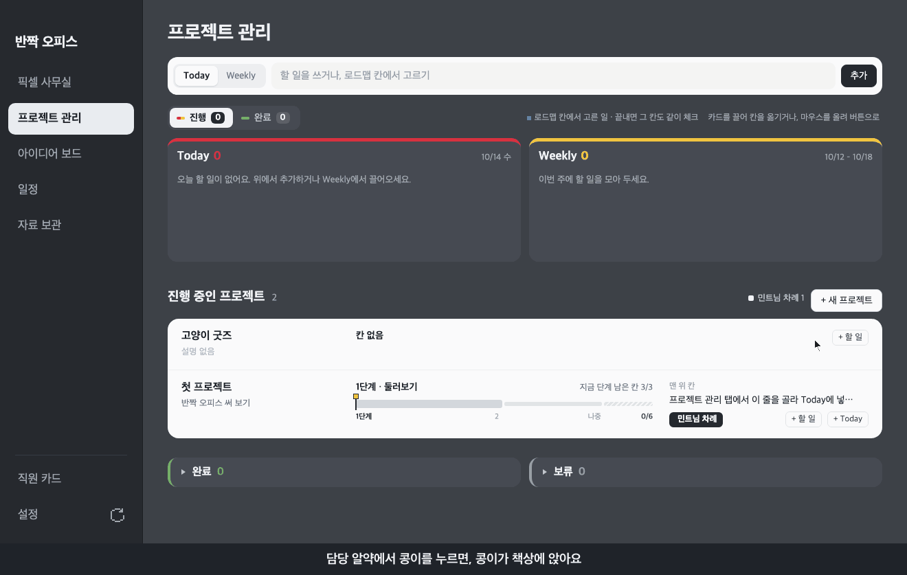
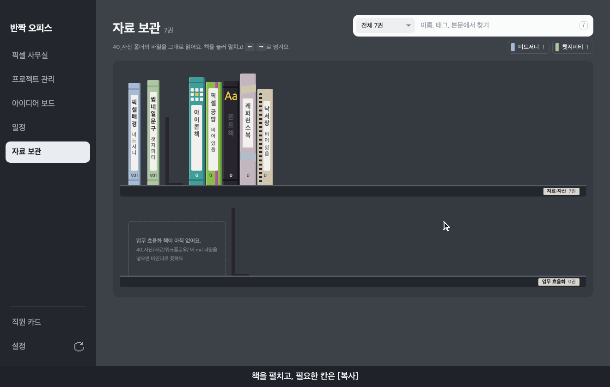
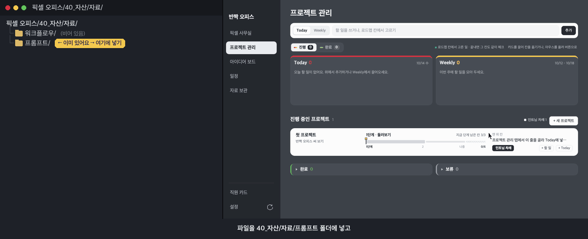
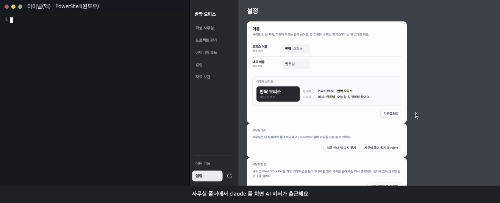
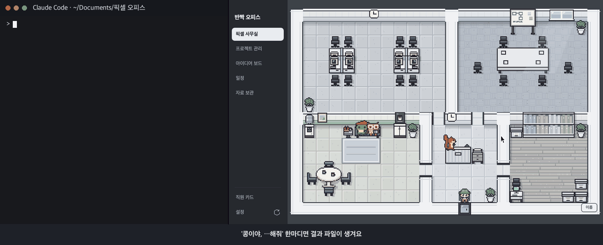

# 픽셀 오피스 (Pixel Office)

**폴더 하나가 사무실이 돼요.**
할 일과 아이디어를 동물 직원들과 함께.

`무료` `macOS` `Windows`

## 목차

- [받기](#받기)
- 써 보기 (짧은 영상): [새 사무실 만들기](#새-사무실-만들기) · [사무실 둘러보기](#사무실-둘러보기) · [로드맵에서 할 일 고르기](#로드맵에서-할-일-고르기) · [할 일 끝내기](#할-일-끝내기) · [프로젝트 로드맵 만들기](#프로젝트-로드맵-만들기) · [직원에게 일 맡기기](#직원에게-일-맡기기) · [직원 소개](#직원-소개) · [책꽂이 둘러보기](#책꽂이-둘러보기) · [새 책 만들기](#새-책-만들기)
- AI 직원 부르기 (선택, 짧은 영상): [클로드 코드로 사무실 열기](#클로드-코드로-사무실-열기) · [직원 부르기](#직원-부르기) · [헷갈려요](#헷갈려요)
- [폴더 안은 이렇게 생겼어요](#폴더-안은-이렇게-생겼어요) · [Pixel Office Pet](#pixel-office-pet-세트-앱) · [라이선스](#라이선스) · [문의](#문의)

---

## 이런 앱이에요

내 컴퓨터의 **폴더 하나를 픽셀 사무실로 보여 주는** 무료 데스크톱 앱이에요.
할 일, 프로젝트, 아이디어, 일정을 적으면 그 폴더 안에 글 파일(`.md`)로 차곡차곡 쌓여요.

> 폴더는 **사무실 건물**이고 앱은 그 건물을 들여다보는 **창문**이에요. 창문(앱)을 지워도 건물(폴더)은 그대로 남아요.

- 무료예요. 가입이나 로그인이 없어요.
- 적은 내용은 내 컴퓨터 폴더에만 있어요. 서버도, 데이터베이스도 없어요.
- AI 없이 혼자 써도 모든 기능이 돌아가요. AI 에이전트 연결은 원하는 사람만 해요.
- 자동 업데이트가 없어요. 앱이 몰래 스스로 바뀌지 않아요.

---

## 받기

### 맥

**[Pixel-Office-mac-arm64.dmg 받기](../../releases/latest/download/Pixel-Office-mac-arm64.dmg)**

- 애플 칩(M1 이후) 맥, macOS 13(Ventura) 이후에서 돌아가요. **인텔 칩 맥은 안 돼요.**
  - 내 맥 칩 확인하기: 화면 왼쪽 위 **사과 모양 메뉴** > **이 Mac에 관하여** > "칩" 줄에 **Apple M**으로 시작하는 이름이 있으면 애플 칩이에요.

1. 받은 `.dmg` 파일을 더블클릭해요.
2. 열린 창에서 **Pixel Office** 아이콘을 **Applications(응용 프로그램)** 폴더 쪽으로 끌어다 놓아요.
3. **응용 프로그램** 폴더에서 **Pixel Office**를 더블클릭해요.
4. 처음 열 때 경고 창이 떠요. 무료 개인 앱이라 애플의 유료 인증을 받지 않아서 뜨는 창이에요. 걱정하지 않아도 돼요.
   - 여는 방법: **[경고 창 여는 법 안내 페이지](https://dangnuie-web.github.io/pixel-office/)**
   - 처음 한 번만 열어 주면, 다음부터는 그냥 열려요.

### 윈도우

**[Pixel-Office-windows-setup.exe 받기](../../releases/latest/download/Pixel-Office-windows-setup.exe)**

- 64비트 윈도우 10·11용이에요. (윈도우 11에서 확인했어요)
  - 내 PC 확인하기: **설정** > **시스템** > **정보** > "시스템 종류" 줄에 **64비트 운영 체제**가 보이면 돼요.

> **설치 파일(exe)** 이란? 앱을 내 PC에 깔아 주는 "설치 도우미"예요. 한 번 실행하면 앱이 깔리고, 그다음부터는 시작 메뉴에서 켜요.

1. 위 링크를 눌러 받아요.
   - 브라우저가 "흔히 다운로드되지 않는 파일" 같은 경고를 붙일 수 있어요. 그러면 받은 파일 옆 메뉴(엣지는 **…**)에서 **유지**를 눌러요. 한 번 더 물으면 **그래도 유지**를 눌러요. 글과 버튼 이름은 브라우저마다 조금 달라요.
2. 받은 `Pixel-Office-windows-setup.exe`를 더블클릭해요.
3. 파란 **"Windows의 PC 보호"** 창이 뜨면, 글 아래 작은 글씨 **추가 정보**를 눌러요. 새로 나온 **실행** 버튼을 눌러요.
   - 순서 다시 보기: [경고 창 여는 법 안내 페이지 — 윈도우](https://dangnuie-web.github.io/pixel-office/#windows)
4. 설치 창이 잠깐 떴다 사라지면 끝이에요. 관리자 암호는 묻지 않아요. 내 사용자 계정에만 깔려서 그래요.
5. 시작 메뉴에서 **Pixel Office**를 눌러 켜요.

**경고는 두 번 뜰 수 있어요. 서로 달라요.**

| 언제 | 누가 띄워요 | 어떻게 넘겨요 |
|---|---|---|
| 받을 때 | 브라우저 | 받은 파일 옆 메뉴(엣지는 **…**) > **유지** |
| 설치 파일을 처음 실행할 때 | 윈도우 ("Windows의 PC 보호") | **추가 정보** > **실행** |

- 둘 다 무료 개인 앱이라 마이크로소프트 쪽 유료 서명(앱 신분증)을 받지 않아서 뜨는 창이에요. 앱이 위험하다는 뜻은 아니에요.
- **실행 버튼이 아예 없어요!** 윈도우 11의 **스마트 앱 컨트롤**이 켜진 PC는 서명 없는 앱을 막아요([Microsoft 공식 도움말](https://support.microsoft.com/kb/5008908)). 이런 PC에서는 지금 판을 열 수 없어요.

**윈도우에서 쓸 때**

- 쓰는 법은 맥과 같아요. 단축키는 맥의 `Cmd` 자리에 `Ctrl`을 눌러요. 예: 새로고침 `Ctrl+R`.
- 사무실 폴더 기본 자리는 **문서** 폴더 안 `픽셀 오피스`예요.
- 앱이 기억하는 것(고른 사무실 폴더 자리, 대표 이름)은 `%APPDATA%\Pixel Office Public\`에 있어요.
  - **`%APPDATA%`** 란? 윈도우가 앱 기억을 넣어 두는 숨은 폴더의 "줄임 이름"이에요. 파일 탐색기(`Windows 키 + E`) 위쪽 주소창에 그대로 붙여 넣고 **Enter**를 누르면 열려요.
- 지우기: **설정** > **앱** > **설치된 앱**(윈도우 10은 **앱 및 기능**)에서 **Pixel Office**를 **제거**해요. 문서 폴더의 `픽셀 오피스` 폴더(내가 적은 것)는 그대로 남아요.

> 꼭 이 저장소의 [릴리스 페이지](../../releases)에서만 받아요. 다른 곳에 올라온 파일은 누가 바꿔 놨을 수도 있어요.

### 코드로 바로 실행하기

설치 파일 대신 이 저장소 코드로 바로 켤 수도 있어요. [Node.js](https://nodejs.org) 22.12 이후가 있어야 해요(맥에서 확인했어요).
저장소를 받은 폴더(`git clone` 또는 **Code** > **Download ZIP**을 푼 폴더)에서 터미널을 열고:

```
npm install
npm start
```

- `npm install`은 처음 한 번만 하면 돼요. 처음 `npm start` 할 때 앱 실행 틀(Electron)을 이 폴더의 `node_modules/` 안에 받느라 조금 걸려요.
- `npm start`로 켠 앱도 설치 파일로 켠 앱과 똑같은 앱이에요. 처음 켜기부터 시작해요.

---

## 새 사무실 만들기



처음 켜면 환영 화면에서 **[새 사무실 만들기]**를 누르고, 네 단계를 지나 사무실에 들어가요. 화면 위 막대에 지금 단계가 보여요.

```
자리 → 이름 → 직원 → 입장
```

- **자리**: 사무실 폴더를 둘 곳을 골라요. 기본은 **문서** 폴더이고, 그 안에 "픽셀 오피스" 폴더가 새로 생겨요.
- **이름**: 오피스 이름과 대표(나) 이름을 적어요. 나중에 **설정** 탭에서 바꿀 수 있어요.
- **직원**: 함께할 동물 직원을 골라 고용해요. 다람쥐 비서는 늘 함께해요.

| 동물 | 하는 일 |
|---|---|
| 다람쥐 | 비서 |
| 부엉이 | 작가 |
| 카멜레온 | 디자이너 |
| 펭귄 | 개발자 |
| 오리 | 정리 담당 |
| 고슴도치 | 검토 |
| 비버 | 기획 |

자세한 건 [직원 소개](#직원-소개)에 있어요.

- 마지막 **[입장하기]**를 누르기 전까지는 아무 파일도 만들어지지 않아요.

---

## 사무실 둘러보기



| 하고 싶은 것 | 키 |
|---|---|
| 걷기 | 방향키 |
| 직원에게 말 걸기, 가구 열기 | 앞에 서서 **Space** |
| 열린 창 닫기 | **Esc** |
| 이름표 보기·숨기기 | **N** |

- 회의실 **칠판**에는 아이디어 보드의 아이디어가 포스트잇으로 붙어요.
- 입구 **서류함**에는 내 차례인 일이 쌓여요. 자료보관실 **책꽂이**는 자료 보관 탭과 같아요.

---

## 로드맵에서 할 일 고르기



**로드맵**은 프로젝트의 체크리스트예요. 처음 사무실에는 연습용 "첫 프로젝트" 로드맵이 들어 있어요.

1. **프로젝트 관리** 탭의 입력 칸을 눌러요. 아무것도 안 적어도 추천 목록이 열려요.
2. 목록에서 할 일 한 줄을 눌러요.

- 고른 할 일 카드에는 프로젝트 이름과 **작은 점**이 붙어요. 로드맵과 이어졌다는 표시예요.

---

## 할 일 끝내기



할 일 카드 왼쪽의 **네모 칸**을 눌러요.

- 로드맵에서 고른 할 일이면 로드맵의 그 줄도 같이 체크되고, 아래 진행 막대가 한 칸 차요.
- 끝낸 카드는 위 **[완료]**를 누르면 보여요. 잘못 눌렀으면 네모 칸을 한 번 더 눌러요.

---

## 프로젝트 로드맵 만들기



1. **진행 중인 프로젝트** 오른쪽 **[+ 새 프로젝트]** → 이름 적기 → **[만들기]**
2. 새 줄의 **[+ 할 일]** → 할 일 한 줄 적기 → **담당** 고르기 → **[넣기]**

- 할 일은 지금 단계의 맨 끝에 붙어요. 끝난 프로젝트 폴더는 `02_완료`로, 멈춘 건 `03_보류`로 직접 옮겨요.

---

## 직원에게 일 맡기기



[+ 할 일]에서 **담당** 알약으로 직원 이름을 누르고 **[넣기]**.

- 직원은 맡은 줄이 로드맵에서 **맨 위의 안 끝낸 줄**이 되면 자기 책상에 앉아요. 없으면 휴게실에 있어요.
- 막 만든 빈 프로젝트에 넣으면 바로 맨 위 줄이라, 15초쯤 안에 책상에 앉아요.
- 직원 앞에서 **Space**를 눌러 끝까지 넘기면 버튼이 두 개 있어요. **[바로 하기]**는 그 직원 일에 맞는 앱 화면(예: 부엉이 = 아이디어 보드)을 열고, **[AI에게 맡기기]**는 "콩이야, …해줘" 같은 예시 문장을 복사해요. 직원 카드에도 같은 두 버튼이 있어요.

## 직원 소개

처음 켜기 ④ 직원 단계에서 고용할 동물을 골라요. **동물마다 맡는 일이 정해져 있어요.** 이름은 마음대로 지어 주면 돼요(비우면 직업 이름으로 불러요).
나중에는 **직원 카드** 탭에서 **[고용]**·**[해고]**·**[이름 바꾸기]** 해요. 해고해도 지워지지 않고, 다시 고용하면 그대로 돌아와요.

> 직원은 **역할을 보여 주는 캐릭터**예요. 앱 안에서 직원이 스스로 일을 해 주지는 않아요. 일은 내가 하거나, 내가 연결한 AI가 해요.

| 동물 | 맡는 일 | 이런 직원이에요 |
|---|---|---|
| 다람쥐 | 비서 | 늘 함께해요(고용을 끌 수 없어요). 입구 안내 데스크에서 맞아 주고, 내 차례인 일이 있으면 마중 나와요. |
| 부엉이 | 작가 | 이야기·글을 맡아요. 책상에서는 첫 문장을 고르고 있어요. |
| 카멜레온 | 디자이너 | 그림·화면을 맡아요. 직원 카드에 **[프롬프트 조합]**·**[픽셀 공방]** 버튼이 있어요(고용 안 하면 대표 카드로 옮겨 가요). |
| 펭귄 | 개발자 | 코드를 맡아요. 책상에서는 버그 냄새를 맡고 있어요. |
| 오리 | 정리 담당 | 자료 정리를 맡아요. 쉴 때는 휴게실 대신 자료보관실에서 대걸레질을 하고, 차례가 오면 책꽂이 앞에 서요(할 일에 "계획"이 들어 있으면 책상). |
| 고슴도치 | 검토 | 틀린 곳 찾기를 맡아요. 작은 실수도 가시에 걸려요. |
| 비버 | 기획 | 순서 짜기를 맡아요. 무엇부터 할지 정하는 걸 좋아해요. |

- 직원 앞에서 **Space**를 누르면 한마디 해요. 쉴 때와 일할 때 말이 달라요.
- 직원이 앉은 책상 앞에서 **Space**를 누르면 그 직원이 맡은 줄이 보여요.

### 일 맡기는 법

> 식당 주문서에 "담당: 콩이"라고 적어 두는 것과 같아요. 콩이 차례가 오면 콩이가 자리에 앉아요.

1. **프로젝트 관리** 탭에서 프로젝트 줄의 **[+ 할 일]**을 눌러요.
2. 할 일을 한 줄 적어요.
3. 아래 **담당** 알약에서 직원 이름을 눌러요.
4. **[넣기]**를 눌러요.

- 그 줄이 로드맵에서 **맨 위의 안 끝낸 줄**이 되면, 그 직원이 자기 책상에 앉아요. 앞 줄을 다 끝내면 차례가 와요.
- 맡은 줄이 없는 직원은 휴게실에 있어요.
- 다람쥐 비서는 따로 책상이 없어요. 비서에게 맡겨도 입구 안내 데스크 자리 그대로예요.
- 내 이름이나 **없음**을 고르면 **내 차례**예요. 입구 서류함에 쌓여요.

### AI 연결은 선택이에요

- **AI 없이도 모든 기능이 돌아가요.** 할 일 적기, 체크, 직원 자리 바뀜은 모두 앱이 폴더 파일만 읽어서 해요.
- AI 에이전트 **Claude Code**를 쓰면, 사무실의 동물 직원을 **진짜 AI 직원**으로 부를 수 있어요. 고용할 때 사무실 폴더 `.claude/agents/`에 그 직원의 **설명서**(AI가 읽는 업무 안내서)가 생기고, `.claude/skills/`에는 직원이 꺼내 쓰는 **스킬** 8개가 처음부터 들어 있어요.
- AI가 폴더 안 파일을 바꾸면 앱이 15초 안에 저절로 다시 읽어요. 바로 보려면 사이드바 맨 아래 **⟳**(또는 맥 `Cmd+R`·윈도우 `Ctrl+R`).
- AI에게 맡기기 전에 "픽셀 오피스" 폴더를 통째로 복사해 백업해 두세요.

---

## 책꽂이 둘러보기



**자료 보관** 탭은 `40_자산` 폴더를 두 단 책꽂이로 보여 줘요. 책을 눌러 펼치고 **←** **→**로 넘겨요. 닫기는 **Esc**.

- 위 단은 자료·자산(프롬프트 자료책·아이콘·픽셀 공방·폰트·레퍼런스·낙서장), 아래 단은 업무 효율화(워크플로우 책·스킬책)예요.
- 자료책 안 글 덩어리마다 **[복사]** 버튼이 있어요.
- 처음 켜면 위 단 맨 왼쪽에 흰 **처음 안내** 책이 꽂혀 있어요. 장마다 짧은 영상과 따라 하기 말풍선이 있어요. 다 보면 마지막 쪽 **[버리기]**.

---

## 새 책 만들기



글 파일 하나가 책 한 권이에요. `날짜_도구_내용_v01.md` 이름으로 `40_자산/자료/프롬프트/`(일하는 순서는 `자료/워크플로우/`)에 넣고 **자료 보관** 탭을 열어요.

- 예: `20261014_챗지피티_썸네일문구_v01.md` → 챗지피티 색 책
- 정해진 도구(미드저니·챗지피티·제미나이·힉스필드·클로드·블로그·n8n·노코드)는 책등 색이 있어요. 그 밖은 회색 책이 돼요.

---

## 클로드 코드로 사무실 열기



**Claude Code**는 글로 시키면 폴더 안 파일을 읽고 쓰는 AI예요. 공식 안내 [code.claude.com/docs/en/setup.md](https://code.claude.com/docs/en/setup.md)에서 받아요(맥은 터미널, 윈도우는 PowerShell에 한 줄).

1. **설정** 탭 → **[사무실 폴더 열기]**로 사무실 폴더 자리를 확인해요.
2. 터미널(윈도우는 PowerShell)에서 그 폴더로 들어가요. 예: `cd ~/Documents/"픽셀 오피스"`
3. `claude`를 쳐요. 사무실 폴더에서 켜야 직원과 스킬을 알아봐요.

- Pixel Office는 무료지만, Claude Code는 **무료 플랜으로는 못 써요.** Claude 구독이나 API 계정이 있어야 해요. 가격은 [공식 요금표](https://claude.com/pricing)를 확인해요.

## 직원 부르기



**"콩이야, 첫 프로젝트 소개 글 세 줄로 써줘"**처럼 직원 이름을 불러요. 결과 파일은 사무실 폴더 안에 생겨요.

- 문장이 떠오르지 않으면 앱에서 직원 앞 **Space** → **[AI에게 맡기기]**. 예시 문장이 복사돼요. Claude Code에 붙여 넣으면 돼요.
- 다람쥐 비서는 Claude Code 자체라 이름 없이 말해도 돼요.
- 스킬은 `/`를 쳐서 목록에서 고르거나 "정리 점검 해줘"처럼 말로 불러요. 자료 보관함 **스킬책**에서 8개를 볼 수 있어요.
- 7종 말고 나만의 직원도 만들 수 있어요. Claude Code에 "직원 설명서 양식으로 번역 담당 직원 만들어줘"라고 시키면 `.claude/agents/`에 새 설명서가 생겨요. 양식은 자료 보관함 워크플로우 책에 있어요.

<details>
<summary>직원마다 이런 걸 맡겨요 (같이 쓰면 좋은 스킬·승인·MCP)</summary>

| 직원 | 왜 필요해요? | 같이 쓰면 좋은 스킬 | 승인해 두면 편한 기능 | 연결하면 좋은 MCP |
|---|---|---|---|---|
| 다람쥐 비서 | 누구에게 맡길지 골라 주는 사람이 있어야 직원을 일일이 안 골라요 | 모두 부를 수 있음(짝 직원에게 넘기는 게 좋아요) | 10_프로젝트 쓰기, 명령은 묻게 | 노션 |
| 부엉이 작가 | 글이 없으면 디자인도 개발도 담을 게 없어 멈춰요 | blog-frame, prompt-combo | 10_프로젝트 쓰기 | 노션 |
| 카멜레온 디자이너 | 색·글꼴 기준이 없으면 화면마다 따로 놀아요 | design-board, image-convert, pixel-convert, prompt-combo (+ figma·frontend-design 플러그인) | 10_프로젝트·40_자산 쓰기, 웹 찾기 | 피그마 |
| 펭귄 개발자 | 직접 실행해 보고 넘겨서 "안 열려요"를 줄여요 | image-convert (+ frontend-design·code-review 플러그인) | 10_프로젝트 쓰기, `npm run` 명령. 설치·올리기·지우기는 묻게 | Playwright(브라우저), 깃허브 |
| 오리 정리 담당 | "최종2·진짜최종"이 쌓이기 전에 계획서부터 보여 줘요 | cleanup-scan, name-check, old-version-cleanup | 정리 폴더 쓰기. 옮기기·지우기는 묻게 | 없어도 돼요 |
| 고슴도치 검토 | 만든 사람 눈엔 자기 실수가 안 보여요. 내보내기 전 다른 눈 | name-check, design-board (+ code-review 플러그인) | 검토 폴더에만 쓰기 | Playwright(브라우저) |
| 비버 기획 | 로드맵에 담당 줄이 있어야 직원이 일할 차례가 와요 | (pm-execution·pm-market-research 플러그인) | 10_프로젝트 쓰기, 웹 찾기 | 노션 |

- 승인은 Claude Code에서 `/permissions`로 내가 직접 해요. MCP는 `claude mcp add …`로 내가 직접 이어요.
- 플러그인은 남이 만든 것이라 Pixel Office에 안 들어 있어요. Claude Code의 `/plugin` 명령으로 받아요.

</details>

## 헷갈려요

- **[바로 하기]와 [AI에게 맡기기]는 뭐가 달라요?** [바로 하기]는 앱 화면을 열어 주고 **내가** 적어요. [AI에게 맡기기]는 문장을 복사해 주고, Claude Code 안의 **AI 직원**이 파일을 만들어요.
- **직원이 앱 안에서 혼자 일하나요?** 아니요. 앱 속 직원은 역할을 보여 주는 캐릭터예요. 실제 일은 내가 하거나 Claude Code에서 부른 AI 직원이 해요.
- **`.claude` 폴더가 안 보여요.** 점(.)으로 시작하는 숨김 폴더예요. 맥 Finder `Cmd+Shift+.` / 윈도우 11 **보기 → 표시 → 숨긴 항목** / 윈도우 10 **보기 탭 → 숨긴 항목**.
- **CLAUDE.md를 직접 고쳐도 되나요?** 네. 메모장으로도, AI에게 시켜도 돼요. 앱은 고용·해고·이름 바꾸기 때 **"## 직원 명부" 절만** 고쳐요.
- **해고하면 설명서가 지워지나요?** 아니요. `.claude/해고/`로 옮겨질 뿐이에요. 다시 고용하면 그대로 돌아와요.
- **스킬은 직원과 뭐가 달라요?** 직원은 **누가**, 스킬은 **어떻게**(레시피 카드)예요. 스킬 하나를 여러 직원이 같이 써요.
- **승인(권한)·MCP가 뭐예요?** 승인 = Claude Code가 파일을 쓰거나 명령을 돌리기 전에 묻는 것(`/permissions`). MCP = 피그마·노션 같은 다른 앱과 잇는 전화선이에요. 안 이어도 돼요.
- **파이썬이 있어야 하나요?** 아니요. 앱도, 들어 있는 스킬도 파이썬 없이 돌아가요.
- **맥과 윈도우는 뭐가 달라요?** 쓰는 법은 같아요. 단축키 `Cmd` ↔ `Ctrl`, 폴더 창 Finder ↔ 탐색기, Claude Code 켜는 창 터미널 ↔ PowerShell이에요.
- **처음 안내 책을 버렸어요.** 사무실 폴더 `_to_delete`에 있어요(지워지지 않아요). **설정** 탭 → **[처음 안내 책 다시 꽂기]**.

---

## 폴더 안은 이렇게 생겼어요

앱에서 버튼을 누르면, 사무실 폴더 안 **글 파일(`.md`)** 이 바뀌어요.
앱은 이 파일들을 읽어서 화면을 그려요.

> 앱은 **리모컨**, 폴더 속 파일은 **TV 화면**이에요. 리모컨 버튼을 누르면 화면(파일)이 바뀌어요.

### 처음 생기는 폴더

**[입장하기]**를 누르면 이 폴더들이 저절로 생겨요.

```
픽셀 오피스/
├─ CLAUDE.md                     직원 명부 + AI 비서가 읽는 일하는 법
├─ .claude/                      숨김 폴더 (AI 직원용)
│  ├─ agents/                    고용한 직원 설명서 (예: owl.md)
│  └─ skills/                    스킬 8개
├─ 10_프로젝트/
│  ├─ 01_진행/
│  │  └─ 첫 프로젝트/
│  │     └─ 로드맵.md            연습용 체크리스트
│  ├─ 02_완료/                   (비어 있음)
│  ├─ 03_보류/                   (비어 있음)
│  ├─ 할일.md                    프로젝트 관리 탭의 할 일
│  └─ 아이디어보관함.md          아이디어 보드
└─ 40_자산/                      자료 보관 탭 책꽂이
   ├─ 자료/
   │  ├─ 프롬프트/               (비어 있음)
   │  └─ 워크플로우/             처음 안내.md, 직원설명서_양식.md
   ├─ 아이콘/                    (비어 있음)
   ├─ 폰트/
   │  ├─ 영문/                   (비어 있음)
   │  └─ 한글/                   (비어 있음)
   ├─ 낙서/                      (비어 있음)
   ├─ 레퍼런스/                  (비어 있음)
   └─ 픽셀/                      (비어 있음)
```

- `약속.md`(일정)는 처음엔 없어요. **일정** 탭에 첫 일정을 적을 때 생겨요.
- 폴더 이름(`10_프로젝트`, `40_자산` 등)은 바꾸지 마세요. 앱이 이 이름으로 서랍을 찾아요.

**직원 명부** `CLAUDE.md` 는 이렇게 생겼어요. 처음 켜기 ④ 직원 단계에서 고른 직원이 한 줄씩 들어가요.

```
# 반짝 오피스

## 대표
- 민트님

## 일하는 법
이 폴더를 Claude Code로 열면 비서가 민트님과 대화해요. …
(AI 비서가 읽는 안내가 이어져요. AI를 안 쓰면 신경 쓰지 않아도 돼요)

## 직원 명부
아래 모양으로 한 줄에 한 명씩 적으면 사무실에 자리가 생겨요.
"- 이름 (영문id): 직업(동물)."  영문id는 영어 소문자와 - 만. 직업은 동물마다 정해져 있어요(앱이 동물로 읽어요).
- 비서 (squirrel): 비서(다람쥐).
- 콩이 (owl): 작가(부엉이).
- 소라 (chameleon): 디자이너(카멜레온).
```

### 로드맵 한 장: 버튼을 누르면 이렇게 바뀌어요

> **로드맵**은 프로젝트의 체크리스트예요. `- [ ]` 한 줄이 할 일 하나예요.

**① 처음 모습**: `10_프로젝트/01_진행/첫 프로젝트/로드맵.md`

````
# 첫 프로젝트 로드맵

한 줄 목표: 반짝 오피스 써 보기

## 1단계 — 둘러보기

- [ ] 프로젝트 관리 탭에서 이 줄을 골라 Today에 넣고 체크하기 — 담당: 민트님
- [ ] 아이디어 보드에 아이디어 하나 적기 — 담당: 민트님
- [ ] 일정 탭에 일정 하나 적기 — 담당: 민트님

## 2단계 — 직원과 함께

- [ ] 콩이 책상에 가서 Space 눌러 보기 — 담당: 콩이
- [ ] 자료 보관 탭에서 책꽂이 둘러보기 — 담당: 민트님

## 나중에 할 일

- [ ] [+ 새 프로젝트]로 내 첫 프로젝트 만들기

```
줄 모양: ## N단계 — 이름 / - [ ] 할 일 — 담당: 이름 / 끝내면 - [x]
이 상자 안 글은 앱이 읽지 않아요.
```
````

- 2단계 첫 줄은 **처음 켜기에서 고용한 첫 직원**(다람쥐 비서 빼고) 이름으로 들어가요. 직원을 아무도 고용하지 않았으면 이 줄은 없어요.

**② [+ 할 일]로 한 줄 넣은 뒤**

**첫 프로젝트** 줄의 **[+ 할 일]** → "첫 글 주제 정하기" 적기 → 담당 **콩이** → **[넣기]**

```
## 1단계 — 둘러보기

- [ ] 프로젝트 관리 탭에서 이 줄을 골라 Today에 넣고 체크하기 — 담당: 민트님
- [ ] 아이디어 보드에 아이디어 하나 적기 — 담당: 민트님
- [ ] 일정 탭에 일정 하나 적기 — 담당: 민트님
- [ ] 첫 글 주제 정하기 — 담당: 콩이
```

- 맨 아래 줄이 새로 생겼어요. **지금 단계(1단계)의 맨 끝**에 붙어요. 다른 줄은 한 글자도 안 바뀌어요.
- 담당을 **없음**으로 고르면 `— 담당:` 꼬리 없이 들어가요. 그 줄은 내 차례로 쳐요.
- 콩이는 아직 휴게실에 있어요. 맨 위의 안 끝낸 줄이 아니라서요. 앞 세 줄을 끝내면 콩이 차례가 와요.

**③ 할 일을 끝낸 뒤**

첫 줄을 추천 목록에서 골라 Today에 넣고 **네모 칸**을 누르면, 로드맵의 그 줄도 같이 체크돼요.

```
- [x] 프로젝트 관리 탭에서 이 줄을 골라 Today에 넣고 체크하기 — 담당: 민트님 (2026-10-14)
```

- `[ ]` 가 `[x]` 로 바뀌고, 줄 끝에 끝낸 날짜가 붙어요.

### 새 책 한 권: 파일이 책이 되는 모습

자료책은 **글 파일 하나 = 책 한 권**이에요. 책은 버튼이 아니라 **파일을 폴더에 넣어서** 만들어요.

> 도서관 책꽂이에 책을 꽂는 것과 같아요. 폴더에 넣으면 꽂히고, 빼면 사라져요.

**파일 자리와 이름**

```
40_자산/자료/프롬프트/20261014_챗지피티_썸네일문구_v01.md
                      ────────  ──────  ──────── ───
                      날짜      도구    내용     버전
```

- 책등에 **내용**(썸네일문구), **도구**(챗지피티), **버전**(v01)이 보여요.
- 책등 색 = 도구 색이에요. 미드저니·챗지피티·제미나이·힉스필드·클로드·블로그·n8n·노코드는 정해진 색이 있어요. 그 밖의 도구나, 이름이 이 모양이 아니면 회색 책이에요.
- 일하는 순서를 적은 글이면 `자료/워크플로우/` 에 넣어요. 아래 단에 회색 바인더로 꽂혀요.

**파일 안 글 → 책 안 모습**

```
태그: 썸네일, 유튜브
이 책은 썸네일 문구 모음이에요.

## 짧은 문구
3초 만에 끝내는 정리법

## 영어 프롬프트
a cozy pixel office, warm light, top view
```

| 파일 안 | 책 안 |
|---|---|
| 첫 줄 `태그: …` | 찾기에 쓰여요. 없어도 돼요 |
| 그다음 첫 줄 | **책 머리말** |
| 빈 줄로 나눈 덩어리 | **칸 하나**. 칸마다 **[복사]** 버튼 |
| 덩어리 첫 줄이 `## 제목` | 그 칸의 **제목** |
| 제목 줄만 있는 덩어리 | 바로 다음 칸의 제목이 돼요 |
| ```` ``` ```` 로 감싼 부분 | 안에 빈 줄이 있어도 **통째로 칸 하나** |
| `─────` 처럼 같은 기호 5개 이상인 줄 | 칸 사이 **나눔선** |

- 제목 줄은 `## 제목` 말고 `[제목]`, `【제목】`, `1. 제목` 모양도 돼요.
- 앱을 켜 둔 채 넣었으면 **자료 보관** 탭을 다시 열거나 15초쯤 기다려요.

---

## Pixel Office Pet (세트 앱)

바탕화면을 돌아다니며 Pixel Office 사무실의 할 일과 약속을 말주머니로 알려 주는 **다람쥐 비서 펫**이에요.
펫 이름은 사무실 명부의 다람쥐 직원 이름이에요(안 정했으면 "비서").

- 받기
  - 맥: **[Pixel-Office-Pet-mac-arm64.dmg 받기](../../releases/latest/download/Pixel-Office-Pet-mac-arm64.dmg)** (애플 칩 맥, macOS 13 이후)
  - 윈도우: **[Pixel-Office-Pet-windows-setup.exe 받기](../../releases/latest/download/Pixel-Office-Pet-windows-setup.exe)** (64비트 윈도우 10·11)
- **Pixel Office에서 사무실을 먼저 만들어 주세요.** 펫은 Pixel Office가 고른 사무실 폴더를 따라가요.
- 처음 열 때 경고 창: Pixel Office와 같아요. [경고 창 여는 법 안내 페이지](https://dangnuie-web.github.io/pixel-office/)에서 "Pixel Office"를 "Pixel Office Pet"으로 바꿔 읽어 주세요.
  - 맥: 첫 경고 창에 **[휴지통으로 이동]**과 **[완료]** 두 버튼이 같이 나올 수 있어요. **[완료]**를 누르세요.
  - 윈도우: 위 [윈도우](#윈도우) 설치 순서와 같아요(받을 때 **유지**, 실행할 때 **추가 정보** > **실행**). 다 깔리면 시작 메뉴에 **Pixel Office Pet**이 생겨요.
- 켜도 Dock(윈도우는 작업 표시줄)에 아이콘이 생기지 않아요. 화면 오른쪽 아래에 다람쥐가 나타나면 켜진 거예요. 끄기는 다람쥐 오른쪽 클릭 > **종료**.

| 하고 싶은 것 | 하는 법 |
|---|---|
| 아이디어 한 줄 적기 | 다람쥐 클릭 → 적고 **Enter** |
| 약속 적기·알림 받기 | 메모 창 **[약속]** → 날짜·시간·내용 (전날 밤 9시, 1시간 전에 알려 줘요) |
| 그림을 레퍼런스로 보내기 | 그림 파일을 다람쥐 위로 끌어다 놓기 → 주제 고르기 |
| 화면 색 코드 복사 | 오른쪽 클릭 > **색 뽑기** → 원하는 곳 클릭 |
| 내 차례인 할 일 보기 | 오른쪽 클릭 > **(대표 이름) 할 일** |

- **색 뽑기**는 맥 권한이 필요해요. 찍은 화면은 색을 고르는 동안만 쓰고 저장하지 않아요.
  - 처음 색 뽑기를 누르면 "'Pixel Office Pet'이(가) 이 컴퓨터의 화면과 오디오를 기록하려고 합니다" 창이 떠요 → **[시스템 설정 열기]** → **화면 및 시스템 오디오 녹음**(예전 이름 화면 기록) 목록에서 Pixel Office Pet 스위치 켜기 → **[종료 후 다시 열기]**
  - 새 판으로 바꾼 뒤 권한 창이 계속 뜨면: 같은 목록에서 옛 Pixel Office Pet을 골라 **[－]**로 지우고 다시 허용해요. 유료 개발자 인증이 없어서 맥이 판마다 다른 앱으로 봐요.
  - 자세한 순서: [안내 페이지](https://dangnuie-web.github.io/pixel-office/)의 **Pixel Office Pet: 색 뽑기를 처음 쓸 때**
- 사무실 폴더에서 펫이 쓰는 곳은 `10_프로젝트/아이디어보관함.md`·`10_프로젝트/약속.md`(한 줄 더하기만)와 `40_자산/레퍼런스/`(그림 옮기기만)뿐이에요. 인터넷을 쓰지 않아요.
- 펫이 기억하는 것(놓은 자리, 보낸 알림 등)은 맥 `~/Library/Application Support/Pixel Office Pet/`, 윈도우 `%APPDATA%\Pixel Office Pet\`에 있어요.
- 코드로 바로 켜기: 위 **코드로 바로 실행하기**처럼 `npm install` 한 뒤 `npm run pet` (Pixel Office와 같은 Electron을 같이 써요. 펫 코드는 `pet/` 폴더)

---

## 라이선스

- **코드**: MIT License — [LICENSE](LICENSE)
- **그림·캐릭터·대사**: CC BY-NC-ND 4.0 — [LICENSE-ART.md](LICENSE-ART.md)
  - 출처("Pixel Office by Dangnee")를 밝히면 그대로 나눌 수 있어요. 돈 받고 쓰거나 고쳐서 나누는 건 안 돼요.
- 저작권자: Dangnee
- 쓴 오픈소스와 그림 출처: [출처.md](출처.md)

이 저장소의 코드는 맥·윈도우 설치 파일 안에 든 앱 폴더와 같은 내용이에요(설명 주석은 뺐고, `package.json`에 코드로 실행하는 명령만 더했어요). `pet/` 폴더는 Pixel Office Pet 설치 파일 안 앱 폴더와 같아요.

## 문의

궁금한 점이나 고장은 [깃허브 이슈](../../issues)로 알려 주세요. 문의는 이슈로만 받아요.

---

당니오피스에서 만들었어요.
